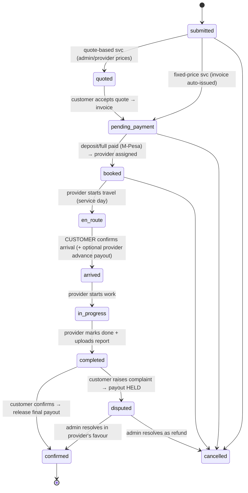

# SMART Drill — Web Platform Design (Customer Journey v1)

> Deep study + full design for the new SMART Drill customer journey, delivered as a **lightweight customer web app** on top of the **existing `/api/v1` backend** (adjusted, not rebuilt). Brand: AntonLiner → **SMART Drill** (smartdrill.co.ke).

---

## 1. Thesis: adjust, don't rebuild

The new journey (request → invoice → pay SMART Drill → assign → schedule → live-track → complete → report → confirm → release) maps closely onto what already exists. We keep the core and add the missing money/documents layer.

**Already built (reuse as-is):**
- The **7 services** as `service_categories` (drillers, test_pump, pump_installer, geologist, tank_installation, surveys→hydro, other_services→consultancy) with provider codes (`SDBDS0001`…).
- **Booking lifecycle** state machine + `booking_events` timeline + ownership-scoped RBAC.
- `scheduled_at` column, **live WebSocket tracking** (`/ws`, token-authed, provider-only publish).
- **M-Pesa** STK + C2B (idempotent), DB-fresh RBAC, audit log, notifications (SMS/FCM/in-app).

**Genuinely new (this design):**
| Need | Status today |
|---|---|
| Human **request number** `SD-HGS-240524-00087` | only `uuid` → add `request_no` |
| **Per-service form fields** (email, county, sampling_date, sampled_by, power source, issue text) | not modeled → add `details` JSON |
| **Document uploads** (survey PDF, test-pump report, provider deliverables, photos/videos) | S3 client exists, no model → add `documents` table |
| **Invoices** issued after confirmation | absent → add `invoices` table |
| **Escrow payouts** to providers (advance on arrival + final on confirm, hold on complaint) | absent → add `provider_payouts` + release logic |
| **Quote flow** (maintenance / consultancy / equipping) | create assumes fixed price → add `pricing_mode` + quote step |
| **Broker / on-behalf-of** requests | absent → add `created_by` + `broker` role |
| **Frictionless** account (no login to request) | customer = OTP-only → add form auto-create + tracking link |
| **Customer confirms completion** gate before payout | provider-driven only → add `customer_confirmed_at` + `confirmed` status |
| **Customer web app** | only Android PassengerApp | new lightweight `customer-web/` |

---

## 2. Actors

- **Customer** — requests services; pays SMART Drill; tracks; confirms completion. Auto-created from the request form (no pre-registration).
- **Broker / agent** — a logged-in professional placing requests **on behalf of** customers (the launch primary user). Role `broker`.
- **Provider** — accepts jobs, sets quotes where applicable, travels (live location), updates status, uploads reports. Uses the **DriverApp** (exists) or a provider web view (later).
- **Admin / staff** (`admin`, `assistance`, `finance`, `owner`) — assign providers, issue invoices, confirm completion, release payouts, resolve complaints, in the **portal**.

---

## 3. Request lifecycle (unified fixed-price + quote)



Notes:
- **`scheduled = booked && scheduled_at != null`** — no separate status; the countdown renders off `scheduled_at`. On the service date the countdown flips to the live map.
- **Actor gates** (extends the rule we already enforce): customer → `arrived` + `confirmed`; provider → `en_route`/`in_progress`/`completed`; admin → any + `quoted`/assignment/refund.
- **Provider live location** visible **only** while `en_route` (already the WS behaviour).

Enum change: `bookings.status` gains `submitted`, `confirmed`, `disputed` (keep the rest).

---

## 4. Money flow (escrow) — the biggest new concept

Two ledgers, kept separate:

**A. Customer → SMART Drill** (`payments`, exists): M-Pesa STK (customer taps pay) or C2B/paybill. Confirms the request (`pending_payment → booked`). This is the money the platform **holds**.

**B. SMART Drill → Provider** (`provider_payouts`, new): the platform's obligation to the assigned provider, released in stages:
- **advance** — optional, released when the customer confirms **arrival** (`arrived`).
- **final** — released when the customer **confirms completion** (`completed → confirmed`) *and* the required report is uploaded.
- **hold** — a complaint (`disputed`) freezes any unreleased payout until admin resolves.

Payout **execution** (actually sending money to the provider): **manual/admin-marked first** (finance clicks "mark paid" after M-Pesa B2C or bank transfer), with **M-Pesa B2C automation** as a phase-2 add-on. This avoids B2C API complexity on day one.

```
customer --M-Pesa STK--> [ SMART Drill escrow ] --advance(on arrival)--> provider
                                                 --final(on confirm+report)--> provider
                          complaint => hold final until resolved
```

Margin = customer price − provider payout (configurable per booking / per provider agreement).

---

## 5. Data model changes

**5.1 `bookings` (alter)**
```sql
ALTER TABLE bookings
  ADD COLUMN request_no        VARCHAR(24)  NULL UNIQUE  AFTER uuid,   -- SD-HGS-240524-00087
  ADD COLUMN created_by        BIGINT UNSIGNED NULL       AFTER customer_id, -- broker/agent (NULL = self)
  ADD COLUMN pricing_mode      ENUM('fixed','quote') NOT NULL DEFAULT 'fixed',
  ADD COLUMN quoted_amount     DECIMAL(12,2) NULL,
  ADD COLUMN customer_confirmed_at DATETIME NULL,
  ADD COLUMN details           JSON NULL;   -- per-service form fields (see 5.5)
-- status enum: add 'submitted','confirmed','disputed'
```
- `request_no` format: `SD-<SVC>-<YYMMDD>-<00000>` where `<SVC>` is a per-category token (HGS, BHD, TPU, WQA, EQP, MNT, CON). Minted in the create transaction like provider codes.
- `provider_id` becomes **nullable** (a `submitted`/`quoted` request has no provider yet) — or use a sentinel until assignment. Recommend NULL + assign on `booked`.

**5.2 `invoices` (new)**
```sql
CREATE TABLE invoices (
  id BIGINT UNSIGNED AUTO_INCREMENT PRIMARY KEY,
  booking_id BIGINT UNSIGNED NOT NULL,
  number VARCHAR(24) NOT NULL UNIQUE,           -- INV-240524-00087
  amount DECIMAL(12,2) NOT NULL,
  status ENUM('issued','paid','void') NOT NULL DEFAULT 'issued',
  due_at DATETIME NULL,
  issued_at TIMESTAMP DEFAULT CURRENT_TIMESTAMP,
  FOREIGN KEY (booking_id) REFERENCES bookings(id)
);
```

**5.3 `documents` (new)** — uploads by customers (survey/test-pump report at request time) and providers (deliverables).
```sql
CREATE TABLE documents (
  id BIGINT UNSIGNED AUTO_INCREMENT PRIMARY KEY,
  booking_id BIGINT UNSIGNED NOT NULL,
  kind ENUM('survey','test_pump_report','deliverable','photo','video','other') NOT NULL,
  url VARCHAR(500) NOT NULL,                     -- S3 key/URL
  content_type VARCHAR(100), size_bytes BIGINT UNSIGNED,
  uploaded_by BIGINT UNSIGNED NULL,
  created_at TIMESTAMP DEFAULT CURRENT_TIMESTAMP,
  FOREIGN KEY (booking_id) REFERENCES bookings(id)
);
```

**5.4 `provider_payouts` (new)**
```sql
CREATE TABLE provider_payouts (
  id BIGINT UNSIGNED AUTO_INCREMENT PRIMARY KEY,
  booking_id BIGINT UNSIGNED NOT NULL,
  provider_id BIGINT UNSIGNED NOT NULL,
  kind ENUM('advance','final') NOT NULL,
  amount DECIMAL(12,2) NOT NULL,
  status ENUM('held','released','paid') NOT NULL DEFAULT 'held',
  released_at DATETIME NULL, paid_at DATETIME NULL, paid_ref VARCHAR(64) NULL,
  FOREIGN KEY (booking_id) REFERENCES bookings(id)
);
```

**5.5 `details` JSON per service** (validated by a Zod schema per category — no schema sprawl):
| Service | details keys |
|---|---|
| Hydrogeological Survey | `email`, `county`, `notes` |
| Borehole Drilling | (survey uploaded as `documents.survey`) |
| Test Pumping | — |
| Water Quality | `sampling_date`, `sampled_by` |
| Borehole Equipping | `power_source` (solar\|grid), (test-pump report doc) |
| Maintenance | `issue_description` |
| Assessment/Consultancy | `problem_description`, (photos/videos docs) |

**5.6 `roles`** — add `broker`. (`agent` already seeded; could reuse.)

All shipped as one idempotent `db/migrate_smartdrill_journey.sql` (same guarded style as `migrate_provider_codes.sql`).

---

## 6. API (new / changed on `/api/v1`)

Reuse existing auth/RBAC/validation middleware.

**Public (frictionless request):**
- `POST /requests` — create a service request. Body: `{ category, full_name, phone, email?, address, lat, lng, details, document_keys[] }`. Auto-creates/updates the customer by phone (no OTP), mints `request_no`, sets `pricing_mode` from the category, issues an invoice (fixed) or marks `submitted` (quote). Returns `{ request_no, tracking_token }`. *(Replaces the auth-gated `POST /bookings` for the public path; keep `/bookings` for app clients.)*
- `POST /uploads/sign` — presigned S3 PUT URL for a document (so the browser uploads directly). Rate-limited.
- `GET /track/:tracking_token` — public read-only request status + timeline + (on service day) live-track handle. No login needed — the token is the capability (sent by SMS/email).

**Customer (OTP login to see full account):**
- `GET /requests` (their own), `GET /requests/:id`
- `POST /requests/:id/pay` (M-Pesa STK — exists as bookings/pay)
- `POST /requests/:id/confirm-arrival` (= transition `arrived`)
- `POST /requests/:id/confirm-completion` (= `completed → confirmed`, releases final payout)
- `POST /requests/:id/complaint` (= `disputed`, holds payout)

**Provider (DriverApp / provider web):**
- `GET /jobs` (assigned, scope=provider), `PATCH /jobs/:id/status` (en_route/in_progress/completed)
- `POST /jobs/:id/quote` (quote-based services → sets `quoted_amount`)
- `POST /jobs/:id/documents` (upload deliverable/report — **gates final payout**)

**Admin / staff (portal):**
- `POST /admin/requests/:id/assign` (assign provider), `POST /admin/requests/:id/invoice` (issue/adjust), `POST /admin/requests/:id/quote` (set quote), `GET /admin/invoices`, `GET /admin/payouts`, `POST /admin/payouts/:id/release`, `POST /admin/payouts/:id/mark-paid`, complaint resolve.

---

## 7. Customer web app (`customer-web/`) — lightweight

**Stack (deliberately lean):** Vite + React 18 + TypeScript · **no heavy UI kit** (hand-rolled CSS or Tailwind/Pico) to keep the bundle small · TanStack Query (few calls) · Maps for the location pin + live tracking · react-router. Reuses the backend axios/refresh pattern from the portal (trimmed).

> Why not reuse the Mantine portal? The customer site is public, marketing-first, and must be fast on mobile — a lean bundle matters. The portal (Mantine) stays the admin tool.

**Pages (from the mockups):**
1. **Home** — hero "Your One-Stop Shop for Borehole Services" + the 7 service cards (icon, description, price/basis, CTA) + "How It Works" (4 steps) + "Not sure where to begin? → Consultancy" + footer. (matches p.1)
2. **Service request page** (one per service, p.3–8) — left: value/"What's Included" + "How It Works"; right: the per-service form (name, phone, email/county where relevant, **map pin + Use My Location**, service-specific fields, **file upload** where required, Confirm). Fixed-price services show the price; quote services show "Request a Quote".
3. **Request submitted / tracking** (p.11) — "Hi {name}! Your request has been submitted." Service, `request_no`, **countdown to service delivery**, status timeline with ✓ (Request Received → Confirmed → Payment Received → Service Delivery). Pay button (M-Pesa) when unpaid.
4. **Live tracking** (p.12) — on service day the countdown becomes a **map**: provider location, site location, ETA, distance, provider name, status. (reuses `/ws`.)
5. **Account** — request history, invoices/receipts, uploaded reports (all linked to the customer). Login via **OTP** (or the tracking link for a single request).

**Frictionless auth:** requesting needs no login (form → auto-account → tracking link SMS/email). Viewing the full account uses OTP. This satisfies operating-rule #3 and the "no account needed" requirement.

---

## 8. Portal (admin) additions

New screens on the existing Mantine portal: **Requests** (queue: submitted/quote-needed/unassigned) with **Assign provider** + **Issue invoice** / **Set quote**; **Invoices**; **Payouts** (release / mark-paid, hold indicators); **Complaints** resolve → release-or-refund. The existing Providers/Bookings/Payments/Reviews/Audit stay.

---

## 9. Cross-cutting

- **Storage**: S3 (client already wired) via presigned PUT; `documents` rows link files to a booking; provider report upload is a **precondition** for final payout release (operating-rule #10).
- **Notifications**: reuse `notify.ts` — request submitted, invoice issued, payment received, provider assigned, scheduled, en route, completed, confirm-please, payout released. SMS carries the **tracking link**.
- **Tracking**: reuse `/ws`; the customer web subscribes with the `tracking_token`-derived access; live only during `en_route`.
- **Request number & invoice number** minted atomically (same pattern as provider codes).
- **Security carry-overs still needed** (from the review): rate limiting (esp. the new public `/requests` + `/uploads/sign`), M-Pesa callback amount validation + IP allowlist, TLS. The public request endpoint needs anti-abuse (rate limit + maybe hCaptcha).

---

## 10. Phased plan

1. **Backend adjust** — migration (5.x), `request_no`/invoice/document/payout models, `/requests` public create + `/uploads/sign`, invoice-on-confirm, escrow payout release logic, status enum. Verify with the live-curl harness.
2. **Customer web MVP** — Home + one service (Hydro) end-to-end: request → invoice → M-Pesa pay → tracking timeline. Then roll out the other 6 forms (they differ only in fields/uploads).
3. **Tracking + completion** — countdown → live map; customer confirm-completion → payout release; complaints.
4. **Portal ops** — assignment, invoices, payouts, complaints screens.
5. **Quote flow + brokers** — quote-based services, broker role/on-behalf, provider quote endpoint.
6. **Phase-2** — M-Pesa B2C payout automation, SEO/prerender for marketing pages, provider web view.

---

## 11. Decisions to confirm (these shape the build)

1. **Customer front-end**: new lightweight `customer-web/` (recommended) — and does the **Android PassengerApp get retired** or kept in parallel?
2. **Provider payout execution**: manual/admin-marked first (recommended) vs M-Pesa **B2C** automation now.
3. **Customer auth**: frictionless request + tracking-link + OTP-for-account (recommended) vs require OTP up front.
4. **Escrow split**: is there always an **advance on arrival**, or final-only? And how is the provider's cut set (per-provider % vs per-booking)?
5. **Payment UX**: STK push (customer taps pay in-app) vs paybill invoice number (customer pays manually) — or both.
